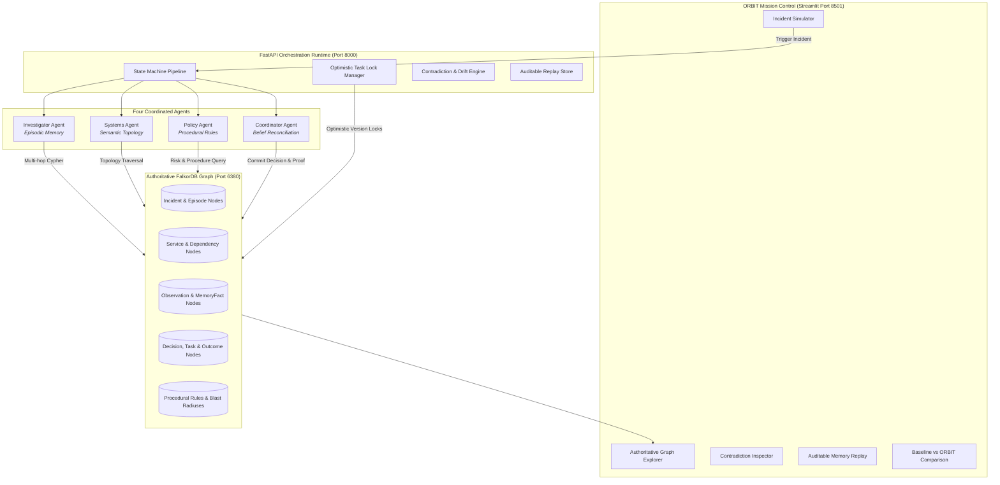

# 🪐 ORBIT — Operational Recall & Belief Integration for Teams

> **Persistent, typed graph memory and coordination runtime for AI incident agents built on FalkorDB.**
> *Track 2: Agent Memory and Coordination — Hackathon Submission*

[](https://www.python.org/downloads/)
[](https://www.falkordb.com/)
[](https://fastapi.tiangolo.com/)
[](https://streamlit.io/)
[]()

---

## 🌟 The Pitch

When an AI agent investigates a production incident, **ORBIT remembers not just what happened, but which hypotheses were tested, which actions failed, why a decision was made, who owns the affected systems, and whether the same lesson applies to today's incident.**

Instead of dumping raw chat logs into an unstructured vector store or relying on fleeting in-context windows, ORBIT treats agent memory as an **authoritative, evolving knowledge graph** with explicit provenance, confidence weights, temporal timestamps, and multi-hop Cypher traversals.

### The Killer Feature: Memory That Disagrees With Itself

Most agent memory demos show an agent recalling a previous chat transcript. **ORBIT solves a harder distributed systems problem: what happens when yesterday's knowledge conflicts with today's evidence?**

```
┌────────────────────────────────────────────────────────────────────────┐
│                        INCIDENT DISCOVERY TRIAD                        │
├─────────────────────────┬────────────────────────┬─────────────────────┤
│   Investigator Agent    │     Systems Agent      │    Policy Agent     │
│   (Episodic Memory)     │   (Semantic Memory)    │ (Procedural Memory) │
├─────────────────────────┼────────────────────────┼─────────────────────┤
│ Recalls checkout cache  │ Discovers checkout     │ Flags that cache    │
│ exhaustion in past      │ migrated to cluster    │ restarts previously │
│ incident (INC-2026-0901)│ (v2.4.0, pool size 64) │ crashed core db     │
│ Proposes cache restart. │ Contradicts restart!   │ Mandates safe check │
└─────────────────────────┴────────────────────────┴─────────────────────┘
                                    │
                                    ▼
┌────────────────────────────────────────────────────────────────────────┐
│                   Coordinator Agent (Belief Integration)               │
│ • Reconciles conflicting hypotheses using FalkorDB graph evidence      │
│ • Supersedes stale facts without deleting historical provenance        │
│ • Selects safe non-destructive diagnostic, preventing DB stampede      │
└────────────────────────────────────────────────────────────────────────┘
```

---

## 🏗️ High-Level Architecture



---

## 🕸️ FalkorDB Graph Data Model

ORBIT enforces strongly-typed graph nodes and explicit relationship edges.

### Node Types
| Node Label | Key Attributes | Purpose |
|---|---|---|
| `Incident` | `id`, `service`, `severity`, `created_at`, `status`, `description` | Root incident entity |
| `Episode` | `id`, `session_id`, `incident_id`, `started_at`, `ended_at`, `status` | Investigation session boundary |
| `Observation`| `id`, `claim`, `source_id`, `observed_at`, `confidence`, `raw_data` | Direct agent telemetry and findings |
| `MemoryFact` | `id`, `content`, `memory_type` (*episodic, semantic, procedural*), `valid_from`, `valid_to`, `status` | Core long-term atomic belief |
| `Decision` | `id`, `action`, `rationale`, `created_at`, `recommended_by`, `status` | Coordinated remediation action |
| `Task` | `id`, `owner_id`, `status` (*unclaimed, claimed, completed*), `version` | Optimistic concurrency work unit |
| `Outcome` | `id`, `result` (*success, failure*), `verified_at`, `details`, `impact_level` | Verified post-incident learning |
| `Procedure`| `id`, `name`, `preconditions`, `risk_level`, `failure_modes` | Runbooks and operational safeguards |
| `Service` | `id`, `name`, `version`, `cache_type`, `pool_size`, `timeout_ms` | Microservice infrastructure topology |
| `Agent` | `id`, `role`, `status`, `current_incident_id` | Autonomous specialized agent identity |

### Relationships
* `(:Agent)-[:OWNS]->(:Task)`
* `(:Agent)-[:CONTRIBUTED]->(:Observation)`
* `(:Episode)-[:CONTAINS]->(:Observation)`
* `(:Observation)-[:SUPPORTS|CONTRADICTS]->(:MemoryFact)`
* `(:Decision)-[:BASED_ON]->(:Observation)`
* `(:Decision)-[:USED_PROCEDURE]->(:Procedure)`
* `(:Decision)-[:RESULTED_IN]->(:Outcome)`
* `(:MemoryFact)-[:SUPERSEDES]->(:MemoryFact)`
* `(:Incident)-[:AFFECTS]->(:Service)`
* `(:Incident)-[:HAS_EPISODE]->(:Episode)`
* `(:Service)-[:DEPENDS_ON]->(:Service)`

---

## ⚡ Key Cypher Traversals in FalkorDB

### 1. Multi-Hop Historical Recall (Avoiding Prior Mistakes)
```cypher
MATCH (i:Incident {service: $service})-[:HAS_EPISODE]->(e:Episode)-[:CONTAINS]->(o:Observation)-[:SUPPORTS]->(f:MemoryFact)
MATCH (f)-[:RELATED_TO]->(d:Decision)-[:RESULTED_IN]->(out:Outcome)
WHERE out.result = 'failure'
RETURN i.id AS incident_id, o.claim AS observation, f.content AS lesson, d.action AS action, out.result AS outcome
ORDER BY out.verified_at DESC
LIMIT 10
```

### 2. Optimistic Concurrency Task Locking (Zero Duplicate Claims)
```cypher
MATCH (t:Task {id: $task_id})
MATCH (a:Agent {id: $agent_id})
WHERE t.version = $expected_version AND t.status = 'unclaimed'
SET t.status = 'claimed',
    t.owner_id = $agent_id,
    t.version = t.version + 1,
    t.updated_at = $now
MERGE (a)-[:OWNS]->(t)
RETURN t.id AS id, t.owner_id AS owner, t.version AS new_version
```

### 3. Temporal Fact Supersession (Provenance Preserved)
```cypher
MATCH (old:MemoryFact {id: $old_fact_id})
SET old.status = 'superseded', old.valid_to = $now, old.superseded_by = $new_fact_id
CREATE (new_f:MemoryFact {
    id: $new_fact_id,
    content: $content,
    memory_type: old.memory_type,
    valid_from: $now,
    status: 'active',
    service: old.service,
    supersession_reason: $reason
})
CREATE (new_f)-[:SUPERSEDES]->(old)
RETURN new_f
```

---

## 🎬 The 4 Demonstration Scenes

| Scene | Name | What Happens | Technical Differentiation |
|---|---|---|---|
| **Scene 1** | **The Cold Start** | Agent starts in a clean session with 0 conversational chat history; successfully recalls past incident precedents, failed actions, and root causes. | Persistent FalkorDB graph memory, not ephemeral in-context prompts. |
| **Scene 2** | **Agents Disagree** | Investigator recalls Redis crash; Systems identifies v2.4 cluster migration; Policy flags restart risk; Coordinator reconciles using graph evidence. | Multi-agent contradiction resolution based on version & evidence timestamps. |
| **Scene 3** | **Lesson Survived** | Verified outcome is recorded; session is reset; next incident dynamically adapts to apply circuit breaker tuning instead of cache restarts. | Cross-session memory persistence and continuous operational learning. |
| **Scene 4** | **Break the Memory** | Stale fact is injected; two agents race to claim a critical task simultaneously; version check rejects duplicate work. | Optimistic concurrency locking & auditable rejection traces. |

> 📽️ **For judges:** See [DEMO_GUIDE.md](./DEMO_GUIDE.md) for a complete step-by-step walkthrough of each scene including what Cypher queries to look for and how to verify FalkorDB is indispensable.

---

## ⚖️ Comparative Evaluation: Without Graph vs With ORBIT

| Evaluation Metric | Without Graph Memory (Naive Baseline) | With ORBIT (FalkorDB Authoritative Graph) |
|---|---|---|
| **Architecture** | Stateless chat / Flat Vector Store | Authoritative FalkorDB Knowledge Graph |
| **Recommended Action** | Restart Redis cache instance immediately | Non-destructive connection pool inspection |
| **Blast Radius** | **CRITICAL**: Causes DB stampede & crashes Postgres | **LOW**: Read-only diagnostic before modification |
| **Aware of Topology Drift?** | ❌ Blind to v2.4.0 Redis Cluster migration | ✅ Traversed live cluster configuration node |
| **Aware of Prior Failure?** | ❌ Repeats disastrous action from `INC-2026-0901` | ✅ Cypher query surfaced prior failure outcome |
| **Duplicate Task Claims** | ⚠️ Multiple agents execute conflicting actions | 🔒 Optimistic version locking prevents duplicate claims |
| **Provenance Audit Trail** | ❌ None (lost when context window resets) | ✅ Complete auditable memory replay snapshot |

---

## 🚀 Quickstart Guide

### Prerequisites
- [Docker Desktop](https://www.docker.com/products/docker-desktop/) (Running)
- Python 3.10+

### 1. Start FalkorDB Container
```bash
# Uses the official falkordb/falkordb Docker image — no local build required
docker compose up -d
```
Verify FalkorDB is running on `127.0.0.1:6380`:
```bash
docker ps | grep orbit-falkordb
```
> **Note:** If the official image fails to pull (network issues), see `docker/Dockerfile` for a local build fallback.

### 2. Install Dependencies & Run Tests
```powershell
# Activate Python Virtual Environment
.\.venv\Scripts\Activate.ps1

# Run the 14 automated test cases
pytest -v tests/
```
Output:
```text
======================== 14 passed in 3.52s ========================
```

### 3. Launch the Mission Control UI
```powershell
.\scripts\start_ui.ps1
```
Open **`http://localhost:8501`** in your browser.

### 4. Launch the FastAPI Orchestration Server
```powershell
.\scripts\start_api.ps1
```
Interactive Swagger API documentation available at **`http://localhost:8000/docs`**.

---

## 📽️ Live Demo Script for Judges

1. **Open Mission Control** at `http://localhost:8501`. Check the sidebar to verify the FalkorDB green indicator.
2. **Tab 1 (Incident Simulator)**:
   - Select **Scene 1 (Cold Start)** and click **Run Scene**. Notice how zero prior chat tokens are used; memories are retrieved directly via FalkorDB Cypher in **<15ms**.
   - Select **Scene 2 (Agents Disagree)** and click **Run Scene**. Watch the three agents present conflicting claims (Episodic vs Semantic vs Policy) and see the Coordinator reconcile them safely.
   - Select **Scene 3 (Lesson Survived)** and click **Run Scene**. Witness the verified lesson get committed to FalkorDB and immediately guide the subsequent session.
   - Select **Scene 4 (Break the Memory)** and click **Run Scene**. View the concurrent task claim audit proving zero duplicate work.
3. **Tab 2 (Graph Explorer)**:
   - Explore the force-directed Pyvis graph. Use the multi-select filter to view specific node types (e.g. `Incident`, `Service`, `MemoryFact`).
4. **Tab 3 (Contradiction Inspector)**:
   - Run the Interactive Contradiction Simulator to see real-time contradiction detection on custom claims.
5. **Tab 4 (Auditable Memory Replay)**:
   - Click the quick selector for `INC-2026-1016-02` to reconstruct the exact state of agent beliefs, active facts, and lessons learned.
6. **Tab 5 (Baseline Comparison)**:
   - Click **Run Head-to-Head Comparative Benchmark** to inspect the stark side-by-side contrast between a naive LLM and ORBIT.

---

## 👥 Team & Workstream Ownership

* **Ayaan Team Lead**: Architecture, FalkorDB schema design, multi-hop Cypher queries, temporal supersession rules, and end-to-end integration.
* **Zain Developer**: Agent coordination state machine, task manager, optimistic locking, and concurrency tests.
* **Saif Developer**: Mission Control UI (Streamlit), Pyvis graph visualizer, contradiction inspector, and replay timeline.
* **Afzaal Tester & Content Writer**: Synthetic scenarios, fault injection fixtures, regression test suite, and release documentation.

---

## 📜 AI Assistance Disclosure
In accordance with hackathon rules, this project utilized agentic AI assistance for code scaffolding, Cypher query optimization, and test generation under continuous human engineering review and verification.
