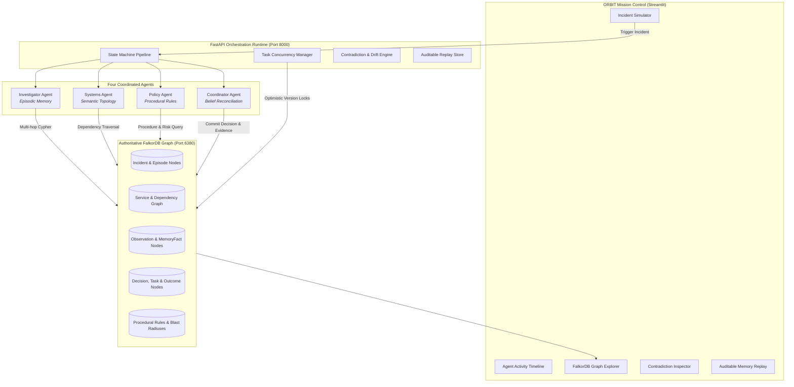

# 🪐 ORBIT — Operational Recall & Belief Integration for Teams

> **Persistent, typed graph memory and coordination runtime for AI incident agents built on FalkorDB.**
> *Track 2: Agent Memory and Coordination — Hackathon Submission*

---

## 🌟 The Pitch

When an AI agent encounters a production incident, **ORBIT remembers not just what happened, but which hypotheses were tested, which actions failed, why a decision was made, who owns the affected systems, and whether the same lesson applies to today's incident.**

Instead of dumping conversation logs into a vector database or flat context window, ORBIT treats agent memory as an **authoritative, evolving knowledge graph** with explicit provenance, confidence, timestamps, and multi-hop Cypher traversals.

### The Killer Feature: Memory That Can Disagree With Itself

Most agent memory demos show an agent recalling a previous chat. **ORBIT solves a harder systems problem: what happens when yesterday's knowledge conflicts with today's evidence?**

1. **Investigator Agent** *(Episodic Memory)*: Recalls that past checkout timeouts were associated with Redis connection exhaustion (`INC-2026-0901`).
2. **Systems Agent** *(Semantic Memory)*: Traverses the live dependency graph and discovers today's checkout service has migrated to a distributed Redis Cluster (`v2.4.0`, pool size 64) with circuit breaker protection.
3. **Policy Agent** *(Procedural Memory)*: Flags that restarting the cache previously triggered a cascading failure on `core-postgres` (dogpile stampede). Policy mandates non-destructive connection inspection before any restart.
4. **Coordinator Agent** *(Belief Integration)*: Resolves the conflicting hypotheses, rejects a blind restart, records the supporting graph evidence path, and commits the verified recommendation into FalkorDB.

---

## 🏗️ High-Level Architecture



---

## 🕸️ The FalkorDB Graph Data Model

ORBIT enforces typed nodes and explicit relationships.

### Node Types
* `Incident`: `id`, `service`, `severity`, `created_at`, `status`, `description`
* `Episode`: `id`, `session_id`, `incident_id`, `started_at`, `ended_at`, `status`
* `Observation`: `id`, `claim`, `source_id`, `observed_at`, `confidence`, `raw_data`
* `MemoryFact`: `id`, `content`, `memory_type` (*episodic, semantic, procedural*), `valid_from`, `valid_to`, `status` (*active, superseded*)
* `Decision`: `id`, `action`, `rationale`, `created_at`, `recommended_by`, `status`
* `Task`: `id`, `owner_id`, `status` (*unclaimed, claimed, completed*), `version`
* `Outcome`: `id`, `result` (*success, failure*), `verified_at`, `details`, `impact_level`
* `Procedure`: `id`, `name`, `preconditions`, `risk_level`, `failure_modes`
* `Service`: `id`, `name`, `version`, `cache_type`, `pool_size`, `timeout_ms`

### Relationships
* `(:Agent)-[:OWNS]->(:Task)`
* `(:Agent)-[:CONTRIBUTED]->(:Observation)`
* `(:Episode)-[:CONTAINS]->(:Observation)`
* `(:Observation)-[:SUPPORTS|CONTRADICTS]->(:MemoryFact)`
* `(:Decision)-[:BASED_ON]->(:Observation)`
* `(:Decision)-[:USED_PROCEDURE]->(:Procedure)`
* `(:Decision)-[:RESULTED_IN]->(:Outcome)`
* `(:MemoryFact)-[:SUPERSEDES]->(:MemoryFact)`
* `(:Incident)-[:AFFECTS]->(:Service)`
* `(:Incident)-[:HAS_EPISODE]->(:Episode)`
* `(:Service)-[:DEPENDS_ON]->(:Service)`

### Essential Cypher Queries

#### 1. Multi-Hop Historical Recall (Failed Recovery Actions)
```cypher
MATCH (i:Incident {service: $service}) -[:HAS_EPISODE]->(e:Episode) -[:CONTAINS]->(o:Observation) -[:SUPPORTS]->(f:MemoryFact)
MATCH (f)-[:RELATED_TO]->(d:Decision) -[:RESULTED_IN]->(out:Outcome)
WHERE out.result = 'failure'
RETURN i.id AS incident_id, o.claim AS observation, f.content AS lesson, d.action AS action, out.result AS outcome
ORDER BY out.verified_at DESC
LIMIT 10
```

#### 2. Optimistic Concurrency Task Claim (Zero Duplicate Work)
```cypher
MATCH (t:Task {id: $task_id})
MATCH (a:Agent {id: $agent_id})
WHERE t.version = $expected_version AND t.status = 'unclaimed'
SET t.status = 'claimed',
    t.owner_id = $agent_id,
    t.version = t.version + 1,
    t.updated_at = $now
MERGE (a)-[:OWNS]->(t)
RETURN t.id AS id, t.owner_id AS owner, t.version AS new_version
```

#### 3. Temporal Fact Supersession (History Preserved, Never Deleted)
```cypher
MATCH (old:MemoryFact {id: $old_fact_id})
SET old.status = 'superseded', old.valid_to = $now, old.superseded_by = $new_fact_id
CREATE (new_f:MemoryFact {
    id: $new_fact_id,
    content: $content,
    memory_type: old.memory_type,
    valid_from: $now,
    status: 'active',
    service: old.service,
    supersession_reason: $reason
})
CREATE (new_f)-[:SUPERSEDES]->(old)
RETURN new_f
```

---

## 🎬 The 4 Demonstration Scenes

| Scene | Name | What Judges See | Technical Differentiation |
|---|---|---|---|
| **Scene 1** | **The Cold Start** | Trigger checkout incident in a fresh session with 0 chat history; agent retrieves past incidents from FalkorDB. | Persistent graph memory, not hard-coded transcripts. |
| **Scene 2** | **Agents Disagree** | Investigator recalls Redis crash; Systems identifies v2.4 cluster migration; Policy flags restart risk; Coordinator reconciles. | Multi-agent contradiction resolution based on version & evidence timestamps. |
| **Scene 3** | **Lesson Survived** | Record verified outcome, reset session, inject similar incident; recommendation adapts. | Cross-session memory persistence and continuous operational learning. |
| **Scene 4** | **Break the Memory** | Inject stale fact & launch concurrent task claims; version check rejects duplicate work. | Optimistic concurrency locking & auditable rejection traces. |

---

## ⚡ Quickstart Guide

### Prerequisites
- Docker Desktop (Running)
- Python 3.10+

### 1. Start FalkorDB
```bash
docker compose up -d
```
FalkorDB will be available on `127.0.0.1:6380`.

### 2. Activate Environment & Run Tests
```powershell
.\.venv\Scripts\Activate.ps1
pytest -v tests/
```
*All 9 test suites verify schema, Cypher recall, contradiction detection, optimistic locking, and cross-session learning.*

### 3. Launch Mission Control UI
```powershell
.\scripts\start_ui.ps1
```
Open your browser at **`http://localhost:8501`**.

### 4. Launch FastAPI Service (Optional)
```powershell
.\scripts\start_api.ps1
```
Interactive Swagger API docs available at **`http://localhost:8000/docs`**.

---

## 👥 Team & Workstream Ownership

* **Ayaan**: Architecture, FalkorDB schema, multi-hop Cypher queries, temporal rules, and end-to-end integration.
* **Teammate 2**: Agent runtime, coordination state machine, optimistic locking, and concurrency tests.
* **Teammate 3**: Mission Control UI (Streamlit), Pyvis graph explorer, contradiction panel, and replay slider.
* **Teammate 4**: Synthetic scenarios, fault injection fixtures, regression test suite, and release docs.

---

## 📜 AI Assistance Disclosure
In accordance with hackathon rules, this project utilized agentic AI assistance for code scaffolding, Cypher query optimization, and test generation under continuous human engineering review and verification.
